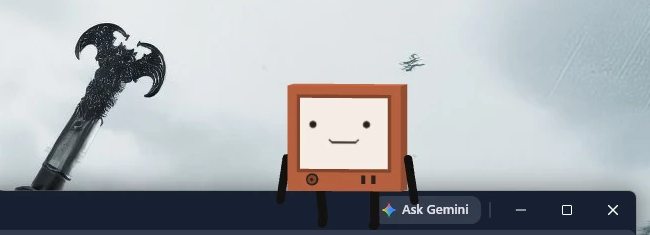
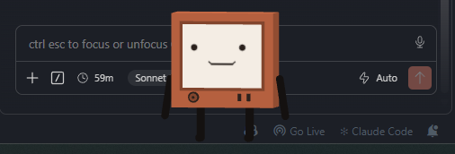
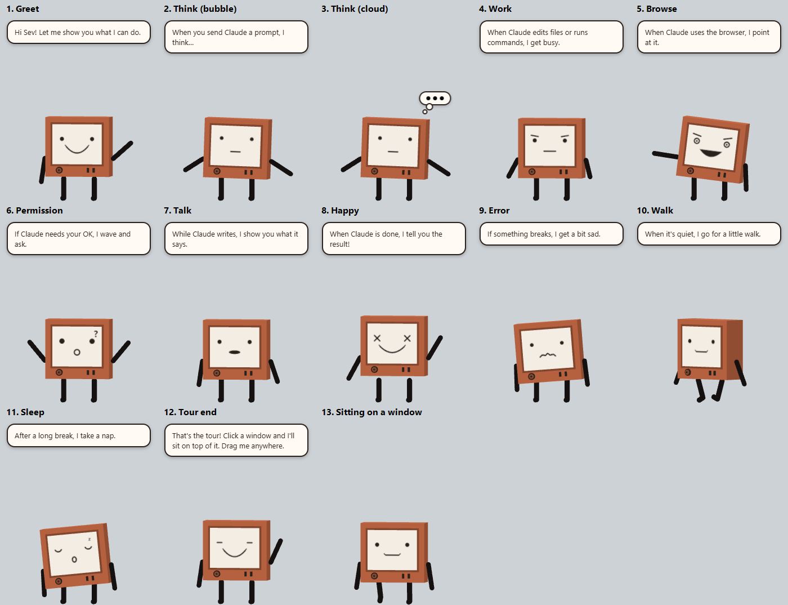

# Rusty

**Rusty is a little animated robot that lives on your desktop and is the face of Claude.**
While you work with [Claude Code](https://code.claude.com) (in the terminal or the Claude desktop
app's Code tab), Rusty shows what Claude is doing: he thinks, gets busy, points at the browser,
asks for your permission, cheers when a task is done and reads a short summary of the reply aloud.
When nothing is happening he strolls along your taskbar or sits on top of the window you're using.

<p align="center">
  <br>
  
</p>

<p align="center">
  
</p>

> Status: a personal project, working daily on **Windows 11**. macOS and Linux are not supported yet
> (sitting on windows uses Windows APIs). Expect rough edges.

## What Rusty does

| When… | Rusty… |
|---|---|
| a Claude Code session starts | waves and says hello |
| you send a prompt | shows a thought cloud with dots |
| Claude edits files or runs commands | looks busy |
| Claude uses the browser | points and looks curious |
| Claude needs your permission | waves both arms and asks (out loud too) |
| Claude finishes | cheers, shows the answer in a speech bubble and reads the first three sentences aloud, then offers to read the rest |
| you say "let's have a discussion" | talks with you and reads the whole reply (needs the optional discussion skill) |
| nothing is happening | strolls along the taskbar, sits on the active window, watches your mouse, naps |

Other details: he follows only the session you last typed into, hops onto the top edge of the window
you click (if it isn't maximised), remembers where you left him, and has a guided tour of all his
states in the tray menu.

## Requirements

- Windows 10 or 11
- [Node.js](https://nodejs.org) 20 or newer
- [Claude Code](https://code.claude.com) (CLI or the Claude desktop app's Code tab), version 2.1 or newer
- About 400 MB of free disk space for the voice model, downloaded automatically on first start
- Optional: [Blender](https://www.blender.org) 5.1, only if you want to change the 3D model

## Install

```bash
git clone https://github.com/Sew-a/rusty-companion.git
cd rusty-companion
npm install
npm start
```

Rusty appears above the taskbar at the bottom right. On first start he downloads the Kokoro voice
model (~326 MB) from Hugging Face; until it's ready he is silent (about 15–30 s, once).

### Connect Rusty to Claude Code

```bash
npm run hooks:install
```

This backs up `~/.claude/settings.json` and adds local `http` hooks that send each Claude Code event
(prompt submitted, tool used, permission needed, reply finished…) to `http://127.0.0.1:47821/event`.
New Claude Code sessions, in the terminal or the desktop app, will now drive Rusty. If Rusty isn't
running, the hooks fail silently and Claude is not affected.

To remove them again: `npm run hooks:uninstall`.

### Optional: discussion mode

Copy `extras/discussion-skill/SKILL.md` to `~/.claude/skills/discussion/SKILL.md`. Then say
"let's have a discussion" (or "what's your opinion on…") in Claude Code: Claude answers
conversationally and Rusty reads the whole reply aloud.

### Start with Windows

Right-click Rusty's tray icon and tick **Start with Windows**.

## Using Rusty

- **Drag** him anywhere. Drop him near the taskbar and he snaps back onto it.
- **Double-click** him to say hi.
- **Click his speech bubble** to hear the rest of a long reply (or to dismiss it).
- **Tray menu:** Show me around (tour), test states, Walk around when idle, Sit on the active window,
  Speak (voice), Start with Windows, Reset position, Quit.

### Personalise

- Your name in greetings: `USER_NAME` in `src/renderer/stateMachine.ts`.
- Voice: `VOICE` and `SPEED` in `src/main/voice.ts` (any English Kokoro voice, e.g. `af_heart`,
  `am_michael`, `bf_emma`; hear samples with `node scripts/voice-samples.mjs`).

## Privacy

Everything runs locally. Claude Code sends hook events only to `127.0.0.1` on your machine. They
include the text of Claude's replies, which Rusty shows and speaks. Events are logged to
`logs/events.jsonl` in the project folder for debugging; delete it whenever you like. The voice model
runs on your CPU, so no audio or text leaves your computer.

## Troubleshooting

- **Rusty doesn't react to Claude:** run `npm run hooks:install`, then start a *new* Claude Code
  session. Check `logs/events.jsonl` is growing. Make sure nothing else uses port 47821.
- **No voice:** the model may still be downloading on first start; see `logs/placement.log` for
  `[voice]` lines. Check **Speak (voice)** is ticked in the tray menu.
- **Voice is slow:** run `node scripts/voice-bench.mjs fp32` to see how fast your CPU makes speech.
- **He doesn't sit on a window:** maximised windows have no room above them, so he stays on the
  taskbar. Un-maximise the window.

## How it's built

Electron + TypeScript + three.js for the transparent always-on-top overlay, a Blender Python script
for the model and its animations, Claude Code `http` hooks for events, Win32 calls (koffi) to find the
active window, and Kokoro-82M (fp32, CPU) for the voice. See [docs/ARCHITECTURE.md](docs/ARCHITECTURE.md).

```bash
npm run build       # bundle with esbuild
npm run typecheck   # TypeScript check
npm run test-event -- Stop "All done!"   # send a fake event to a running Rusty
```

Rebuild the model after editing `blender/build_robot.py`:

```bash
blender --background --factory-startup --python blender/build_robot.py
```

## Credits and licences

- Rusty's design is original (from the author's sketches).
- [Kokoro-82M](https://huggingface.co/hexgrad/Kokoro-82M) and [kokoro-js](https://www.npmjs.com/package/kokoro-js): Apache-2.0
- [Electron](https://www.electronjs.org), [three.js](https://threejs.org), [koffi](https://koffi.dev): MIT
- This project: MIT (see `package.json`; a LICENSE file will be added before a public release).

Rusty is a fan-made helper for Claude Code, not an official Anthropic product.
